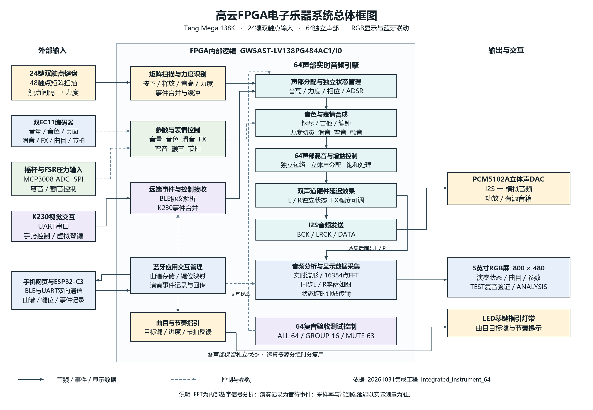

# 高云 FPGA 多维交互电子乐器

全国大学生嵌入式芯片与系统设计竞赛 2026 · 高云半导体赛题二

基于 **Sipeed Tang Mega 138K** 的实时电子乐器。24个双触点实体琴键产生音符与力度事件，FPGA完成64声部合成、表情控制、立体声混音和延迟效果，通过I2S送至PCM5102A。配套800×480 RGB屏、LED曲目指引、ESP32-C3蓝牙交互与K230视觉控制。

## 最终版本入口

**本仓库以用户提供的 `E:\Gowin\Final\FPGA_Instrument_20261031` 为最终工程基线，归档日期为2026年11月1日。** 本次只整理仓库与文档，未修改最终工程的源码、约束、ROM表、工程配置或烧录文件，未运行综合、布局布线或烧录。

| 用途 | 唯一入口 |
| --- | --- |
| 打开最终工程 | [integrated_instrument_64.gprj](final/project/integrated_instrument_64/integrated_instrument_64.gprj) |
| 下载最终烧录文件 | [integrated_instrument_64.fs](final/project/integrated_instrument_64/impl/pnr/integrated_instrument_64.fs) |
| FPGA顶层 | [instrument_64_top.v](final/project/integrated_instrument_64/source/project/instrument_64_top.v)，实例化64声部 |
| 器件与工具 | GW5AST-LV138PG484AC1/I0 · Gowin V1.9.12 |
| 原有本轮PNR报告 | [引脚报告](final/project/integrated_instrument_64/impl/pnr/integrated_instrument_64.pin.html) · [资源报告](final/project/integrated_instrument_64/impl/pnr/integrated_instrument_64.rpt.txt) · [时序报告](final/project/integrated_instrument_64/impl/pnr/integrated_instrument_64.tr.html) |

最终 `.fs` 大小为 **42,340,871字节**，SHA256：

```text
2A1C5EA9A07E9421049F5E1623558A684046DF6744FAAC9D5258CDDCDEC18EF8
```

这份文件来自用户明确指定的 `project/integrated_instrument_64/impl/pnr/`。原目录中 `bitstream/` 的两份旧备份不是本次最终固件，未作为发布固件收录。`final/README.md`、`final/package_manifest.json` 和早期报告保留原字节以便追溯，其中旧的固件入口与校验结论应以本页及[发布说明](docs/RELEASE.md)为准。

## 从哪里开始阅读

| 想了解什么 | 文档 |
| --- | --- |
| 打开工程、选固件、首次检查 | [快速上手](docs/QUICKSTART.md) |
| 系统方案与音频算法结构 | [系统架构](docs/ARCHITECTURE.md) |
| 元件、双触点矩阵、DAC、蓝牙、ADC与灯带接线 | [硬件说明](docs/HARDWARE.md) · [58个端口完整引脚表](docs/PINOUT.md) |
| 双EC11、六页界面、力度与曲目指引 | [操作说明](docs/USER_GUIDE.md) |
| 手机网页、ESP程序、UART命令与回传 | [蓝牙与手机](docs/BLUETOOTH.md) |
| 已有报告、仿真、示波器与64复音验收 | [验证说明](docs/VALIDATION.md) |
| 三位成员的工作如何形成当前工程 | [源码与成员资料导航](docs/SOURCE_MAP.md) |
| 最终文件来源、旧版本区别、打包范围 | [发布说明](docs/RELEASE.md) · [SHA256清单](release/manifest.json) |



## 主要功能

- **24键双触点力度输入**：8行×6列、48触点，逐键时间参数映射到力度，影响音量、音色与起音。
- **64个独立声部状态**：独立音高、相位、力度与包络，分组时分复用运算资源；包含钢琴、吉他、编钟三音色。
- **演奏表情与效果**：滑音、摇杆弯音、FSR颤音、双声道延迟效果。
- **标准I2S**：24位有符号PCM、每声道32位槽、64 BCK/立体声帧，外置PCM5102A线路输出。
- **实时反馈**：波形、16384点FFT、同步左右声道XY图、演奏与曲目状态。
- **练习与手机联动**：脱机曲目、节奏提示、LED目标键、蓝牙曲谱传输、键位映射、演奏事件记录及回传。
- **64复音验收模式**：ALL64、GROUP16、MUTE63；配套PC模拟输出采集分析工具。
- **K230交互**：手势调参与8个虚拟琴键，独立UART输入。

48kHz为设计采样率目标。端到端延迟、实际LRCK频率与DAC模拟频谱需使用对应固件的现场测量记录；本次仓库整理不将历史仿真或目标值改写为最终实测结果。

## 目录

```text
final/                 最终工程原文件及用户指定的唯一发布固件
  project/integrated_instrument_64/
    integrated_instrument_64.gprj
    source/            RTL、CST、SDC、ROM和第三方FFT
    impl/pnr/          最终.fs及已有报告，不含大型实现数据库
  k230/                最终包内K230板端程序
  tools/               最终包内PC采集分析和历史开发工具
  verification/        原有仿真源码、记录和日志
docs/                  本次统一整理的当前方案、接线和使用说明
companion/             原有手机网页与ESP桥接配套源码，标明来源
release/               精确文件哈希、来源与整理检查结果
tools/                 只读发布校验工具
archive/               主干旧内容、任务书和成员历史说明
```

只需演示或烧录时使用上方最终入口；阅读旧资料时从[历史资料导航](archive/README.md)进入。旧开发分支和全部提交历史保留，未强推覆盖。

## 文件校验

在仓库根目录执行，无需安装第三方库，也不会调用Gowin：

```powershell
python -B tools/verify_release.py
```

## 许可与来源

第三方FFT保留[原MIT许可证](final/project/integrated_instrument_64/source/vendor/r22sdf/LICENSE)与作者声明；参见[第三方说明](final/THIRD_PARTY_NOTICES.md)。Gowin工具/IP及K230运行库、模型按提供方授权使用。仓库未擅自为全部团队与第三方内容追加统一开源许可证。
