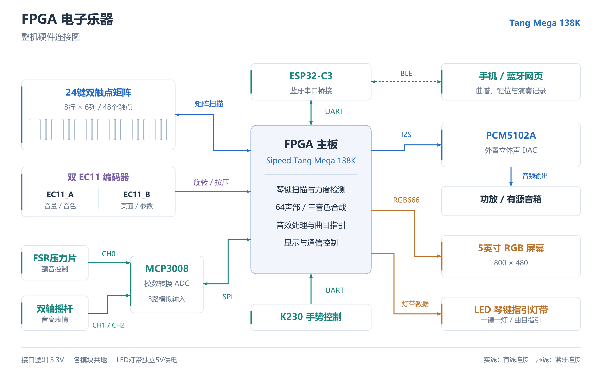

# 高云 FPGA 电子乐器

全国大学生嵌入式芯片与系统设计竞赛 2026 · 高云半导体赛题二

基于 Sipeed Tang Mega 138K，使用24个双触点琴键，支持64声部、钢琴/吉他/编钟三音色与力度响应。音频经立体声 I2S 输出至 PCM5102A，配备800×480 RGB屏、LED曲目指引、蓝牙交互和K230手势控制。

## 工程与固件

| 项目 | 文件或配置 |
| --- | --- |
| Gowin工程 | [integrated_instrument_64.gprj](final/project/integrated_instrument_64/integrated_instrument_64.gprj) |
| 烧录文件 | [integrated_instrument_64.fs](final/project/integrated_instrument_64/impl/pnr/integrated_instrument_64.fs) |
| 顶层 | [instrument_64_top.v](final/project/integrated_instrument_64/source/project/instrument_64_top.v) |
| 器件 | GW5AST-LV138PG484AC1/I0 |
| 开发工具 | Gowin V1.9.12 |

用Gowin打开上述工程。下载现成固件时，在Programmer中选择表内的 `.fs`。

## 文档



- [整机硬件连接与工作原理](docs/HARDWARE_OVERVIEW.md)：连接总图及各模块详细说明；[矢量PDF](docs/figures/hardware_overview.pdf)。
- [系统架构](docs/ARCHITECTURE.md)：信号链、音频引擎、显示与源码目录。
- [硬件接线](docs/HARDWARE.md) · [完整引脚表](docs/PINOUT.md)。
- [操作说明](docs/USER_GUIDE.md)：双EC11、曲目指引、复音测试和分析页面。
- [蓝牙与手机](docs/BLUETOOTH.md)：网页、ESP32-C3、通信协议和曲谱格式。
- [测试与测量](docs/TESTING.md)：文件校验、仿真入口、采样率和延迟测量。
- [版本记录](docs/HISTORY.md)：开发分支归档与恢复方法。

## 目录

```text
final/project/       FPGA源码、约束、ROM、Gowin工程与固件
final/k230/          手势控制程序
final/tools/         PC采集与分析工具
final/verification/  独立验证脚本和testbench
companion/phone/     手机网页
companion/esp32c3/   BLE串口桥接工程
docs/               方案、接线和使用说明
release/            文件校验清单
```

最终工程基准为2026年10月31日交付版本。工程文件及固件保持原字节；历史阶段资料见归档标签。
