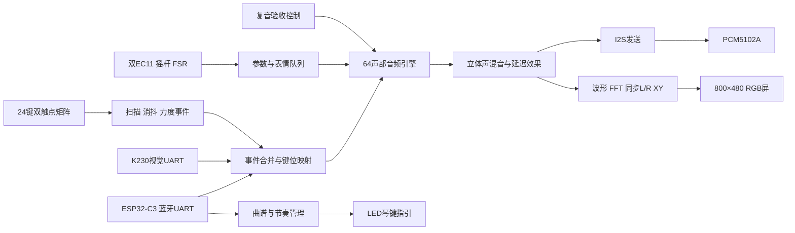

# 系统方案与实现结构

## 硬件信号链

配套[高清框图](figures/system_architecture.png)与[SVG矢量图](figures/system_architecture.svg)可插入技术文档。图示为功能连接概览，精确信号以最终顶层及CST为准。

## 演奏输入与事件

`matrix_scan_8x6.v` 逐行驱动低电平，其余行高阻；6条上拉列线经同步采样，形成48触点快照。`keyboard_24_dual.v` 根据每键A/B触点间隔测力度，消抖后生成NOTE_ON/NOTE_OFF。最终顶层设置 `ROW_CYCLES=307`、按下15帧、释放64帧；力度在触点变化路径捕获，不等同于等待消抖后的两个事件再相减。

键盘默认音符为 `60+key_index`，24键为MIDI60至83。`instrument_link.v` 提供物理键映射，松键使用按下时锁存的音符以避免挂音。远端UART事件与本地事件通过合并逻辑进入音频引擎。公共协议位于最终工程 `source/rtl/common/event_defs.vh`，不能使用历史分支旧编码替换。

## 64声部与三音色

`audio_core.v` 管理64个逻辑声部；各声部保存自己的音高、相位、力度、包络与发声状态。`oscillator_state_bank.v` 按8组×8路共享算术和查表资源，`adsr_state_bank.v` 保存独立包络状态，末级混音按声部累加并饱和处理。

钢琴、吉他、编钟使用音色专用与共享处理结构。吉他含独立弦状态及延迟线，编钟含对应的模态/音色处理；力度参与增益、亮度和起音。`pitch_expression.v` 实现逐声部滑音以及频率表情，FSR颤音是音高调制。

**64独立声部不表示64套完全物理并行运算器。** 每采样调度复用运算；谐波、左右声道和效果器不再额外计为声部。`VOICE_COUNT=64` 由最终外层顶层显式设置。

## 音频输出

`mixer.v` 输出真正左右声道；两路 `audio_delay_fx.v` 分别保留效果状态。`i2s_tx_pcm5102a.v` 在一帧边界同时锁存左右样本，发送Philips I2S：24位有符号PCM、32位声道槽、64 BCK/立体声帧，WS低左高右，新MSB较WS变化延迟一位。

音频设计时钟约12.288MHz，每256拍输出一组样本，目标48kHz；实际采样率以LRCK实测为准。核心流水线拍数仅反映内部延迟，不能替代实体触点闭合至DAC模拟起音的整机延迟。

## 时钟与显示

音频与RGB像素使用各自PLL和复位同步器。状态通过 `lcd_status_bridge.v` 等通路跨域；像素时钟异常不应直接把音频域一直保持在复位。

- 波形采集保留窗口min/max并自动量程，缩放只改变图形，不改变声音。
- 频谱采用16384点FFT，分析内部输出数据；48kHz下窗长约341ms、hop1024约21.3ms。
- XY使用同一采样点的效果后L/R。左右相同时是斜线，不能人为加相位冒充双声道测量。
- ANALYSIS的Hz是所选频带代表频率；幅度是相对量，不是校准声压或外部DAC回采。

## 曲谱 手机与验收支路

`lesson_guide.v` 存内置曲目并管理目标键、节拍和进度；`instrument_link.v` 管理第三曲槽、映射、512项演奏事件记录和UART回包；`keyboard_led_strip.v` 将目标物理键映射到灯带。

`polyphony_test.v` 使用真实声部基波输出进行ALL64、GROUP16、MUTE63测试，测试纯音居中并绕过FX，隔离普通演奏输入。FFT能辅助观察，但最终独立多音证据应结合DAC模拟输出采集与指定声部静音对照。

更多原始实现说明保留在[最终包架构说明](../final/docs/ARCHITECTURE.md)。
