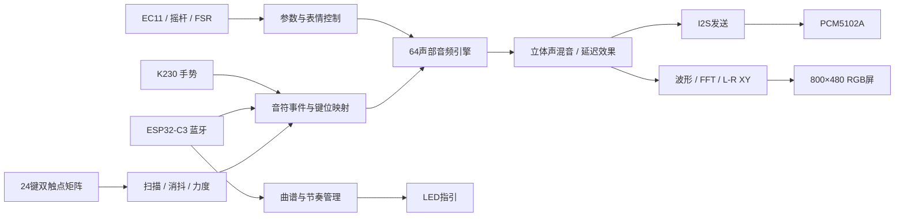

# 系统架构

[PNG框图](figures/system_architecture.png) · [SVG框图](figures/system_architecture.svg)

## 输入与音频

8×6矩阵扫描48个触点，未选中行高阻。每键A/B触点闭合时间差按逐键标定表映射为力度，影响音量、亮度与起音。默认24键对应MIDI 60–83。

音符事件进入64声部音频引擎，各声部独立保存音高、相位、力度及包络状态，运算资源按采样周期复用。三种音色为钢琴、吉他和编钟；滑音、摇杆及FSR调制音高，左右混音后分别进入延迟效果器。

PCM5102A接口采用Philips I2S：24位有符号PCM、每声道32位槽、每帧64 BCK。目标采样率48kHz。

## 显示与曲目

显示域与音频域使用独立时钟，通过状态桥传递数据。波形使用自动量程；频谱为16384点FFT，hop为1024样本；XY绘制同步采样的效果后左右声道。48kHz下分析窗约341ms，更新步长约21.3ms。

内置两首曲目，第三槽由手机上传。LED按物理琴键指引。蓝牙还支持键位映射、512项演奏事件记录和回传；K230走独立UART。

## 源码位置

以下目录位于 `final/project/integrated_instrument_64/source/`：

| 目录 | 内容 |
| --- | --- |
| `project/` | 64声部顶层与系统集成 |
| `rtl/input/` | 矩阵扫描、双触点力度、EC11 |
| `rtl/audio_core/` | 声部分配、振荡器、包络、三音色与混音 |
| `rtl/ui/` | 参数、曲目、显示和交互 |
| `rtl/common/` | 公共事件定义 |
| `constraint/` | 引脚及时序约束 |

具体文件引用以Gowin工程清单为准。
