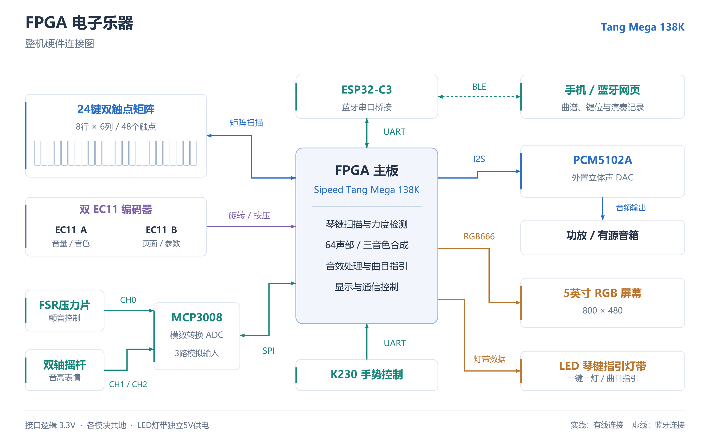

# 整机硬件连接与工作原理



[下载矢量PDF](figures/hardware_overview.pdf) · [下载可编辑SVG](figures/hardware_overview.svg)

图中以FPGA主板为中心，左侧是琴键、编码器和模拟传感器，右侧是音频、屏幕和LED输出，上方是手机蓝牙链路，下方是K230手势控制。实线表示有线接口，虚线表示BLE无线连接，箭头表示数据或控制方向。矩阵扫描和SPI同时包含控制输出与数据输入，因此用双向箭头表示。

这张图用于说明整机组成和接口关系，不表示模块尺寸、安装位置或实际排针顺序。具体接线对应关系见[硬件接线表](HARDWARE.md)和[完整引脚表](PINOUT.md)。

## 1. 整机分工与演奏信号流

FPGA主板为Sipeed Tang Mega 138K，器件为GW5AST-LV138PG484AC1/I0。琴键扫描、力度判断、声部分配、音频合成、音效、曲目指引和显示控制均由FPGA工程实现。ESP32-C3负责手机与FPGA之间的通信，MCP3008负责模拟量采样，PCM5102A负责将数字音频转换为模拟音频。

一次实体琴键演奏的完整过程为：

1. 琴键下方的A、B触点依次闭合。
2. FPGA扫描矩阵，检测触点状态和闭合时间差，完成消抖及逐键力度映射。
3. 生成包含音符、力度和按下/松开类型的事件，送入音频引擎。
4. 音频引擎分配声部，按当前音色、力度、包络和表情参数合成样本。
5. 左右声道经过混音及延迟效果处理，通过I2S送入PCM5102A。
6. DAC从LINE OUT输出模拟音频，经有源音箱或功放发声；屏幕同步显示键位、参数和分析结果。

64复音指音频引擎最多管理64个独立声部，不表示每个琴键叠加64个声音。24个实体琴键产生音符事件，释放包络、延续尾音及其他音符来源也可能占用声部。TEST模式可独立开启64声部进行验证。

## 2. 24键双触点矩阵

### 2.1 机械排列与电气排列

实体琴键排成一排，每个琴键下方有两个触点，共48个触点。电路采用8行、6列矩阵，只需8根行线和6根列线传输触点状态，不需要为48个触点分别占用FPGA输入。

琴键的机械排列和矩阵行列是两回事。矩阵按每6个琴键分组：

| 琴键分组 | A触点所在行 | B触点所在行 | 列对应关系 |
| --- | --- | --- | --- |
| K1–K6 | R0 | R1 | 按顺序对应C0–C5 |
| K7–K12 | R2 | R3 | 按顺序对应C0–C5 |
| K13–K18 | R4 | R5 | 按顺序对应C0–C5 |
| K19–K24 | R6 | R7 | 按顺序对应C0–C5 |

例如K1的A、B触点分别位于R0/C0和R1/C0；K7的A、B触点分别位于R2/C0和R3/C0。同一琴键的两个触点共享列线，分别连接不同的行线。

### 2.2 扫描、上拉与防鬼键

FPGA逐行将选中行驱动为低电平，未选中行保持高阻。6条列线分别上拉至3.3V：触点未闭合时读到高电平；触点闭合且所在行被选中时，列线通过触点和二极管连接到低电平行，FPGA据此识别位置。

每条列线各接一只约10kΩ上拉电阻，共6只。电阻接在3.3V与列线之间，不是串在触点信号路径中。最终约束还启用了内部上拉。

每个触点各串接一只1N4148防鬼键二极管，共48只，带环的阴极端朝行线。二极管限制矩阵中的反向导通路径，降低多个触点同时闭合时产生虚假键位的风险。

焊接时，同名行线上的节点用母线并接，同名列线跨四个琴键组互连。跨越其他网络时使用绝缘导线；只有同一网络的焊点才连接。行列交叉本身不代表应当焊在一起。

### 2.3 力度与音色动态

A触点应先闭合，B触点后闭合。两次闭合之间的时间差反映琴键运动速度：间隔短通常对应快按，间隔长通常对应慢按。触点高度、行程和机械误差会使不同琴键的时间范围不同，因此最终工程采用逐键标定映射。

力度送入音频引擎后同时影响音量、泛音分布和起音包络。较大力度可以产生更强输出、更丰富的高频成分和更陡的起音；较小力度则较柔和。力度和摇杆、FSR的作用不同：力度来自击键过程，后两者属于演奏中的表情控制。

## 3. MCP3008、FSR与双轴摇杆

### 3.1 ADC的作用

FSR和摇杆产生连续变化的模拟电压，不能直接按普通数字GPIO读取。MCP3008是10位、8通道ADC，本工程轮询使用其中3路，转换结果通过SPI送回FPGA。

| ADC通道 | 接入信号 | 用途 |
| --- | --- | --- |
| CH0 | FSR分压输出 | 压力与颤音控制 |
| CH1 | 摇杆VRx | X轴表情输入 |
| CH2 | 摇杆VRy | Y轴表情输入 |

SPI由FPGA控制：CS选择ADC，SCLK提供时钟，MOSI接MCP3008的DIN以发送通道选择，MISO接DOUT以接收采样结果。图中的双向SPI表示这组接口中有发送和接收信号，不是把MOSI、MISO并接。

MCP3008的VDD和VREF使用3.3V，AGND和DGND接公共地，电源和参考端附近布置去耦。模拟输入范围应保持在0至3.3V之内。

### 3.2 FSR分压与压力控制

FSR是随压力变化的电阻元件，需要与固定电阻组成分压。连接关系为：

```text
3.3V ── FSR ──┬── MCP3008 CH0
              │
            固定电阻
              │
             GND
```

该接法中，压力增加使FSR电阻减小，CH0电压上升。固定电阻决定分压范围和灵敏度，应沿用实物标定值；若重新搭建，可从约10kΩ起调。

FPGA对采样值进行有效性判断、零点与范围映射，再生成颤音控制参数。FSR分压电阻与矩阵上拉电阻用途不同，不能因为阻值相似就互相代替。

### 3.3 摇杆连接

双轴摇杆由3.3V供电，VRx和VRy分别送CH1、CH2，共地。摇杆位置变化产生电压变化，FPGA处理中心位置和死区后生成音高表情参数。摇杆按压SW在本工程中未使用。

FSR和摇杆都通过MCP3008接入，不直接连接到琴键矩阵，也不输出音频。

## 4. 双EC11编码器

两个EC11用于本地操作，不经过MCP3008。编码器的两路相位信号和按压信号直接进入FPGA，经同步、消抖和方向判断后更新控制参数。

| 编码器 | 旋转 | 按压 |
| --- | --- | --- |
| EC11_A | 调整主音量 | 短按切换钢琴、吉他、编钟 |
| EC11_B | 调整当前页面的参数 | 短按切页，长按执行页面对应功能 |

EC11_B页面包括GLIDE、FX、SONG、TEMPO、TEST和ANALYSIS；对应操作见[操作说明](USER_GUIDE.md)。

裸EC11的相位公共端接GND，按压触点一端接信号、另一端接GND。当前FPGA约束启用了信号内部上拉；已有外部上拉可保留。裸编码器本身没有需要单独供电的VCC端，模块型编码器则应按其电路和丝印核对。

图中将两个编码器合并在同一框内，表示相同类型的操作器件，不表示两个编码器的信号线互相并联。

## 5. I2S与外置PCM5102A

音频合成在FPGA中完成，PCM5102A负责数字到模拟转换。两者通过I2S连接：

| 信号 | 方向 | 作用 |
| --- | --- | --- |
| BCK | FPGA → DAC | 串行位时钟 |
| LRCK / WS | FPGA → DAC | 左右声道选择与采样帧节拍 |
| DIN | FPGA → DAC | 左右声道PCM数据 |

本工程使用Philips标准I2S，24位有符号PCM、每声道32位槽、每立体声帧64个BCK。目标采样率为48kHz，对应BCK约3.072MHz；实际采样率以LRCK测量为准。

本项目YX69008模块按厂家资料修正采用3.3V端供电，VCC/VIN留空；XMT/XSMT接3.3V解除静音，FMT接地选择I2S，SCK接地使用内部PLL，无需外部MCLK。不同PCM5102A模块的供电电路可能不同，不能直接套用该供电方式。

声音从外置模块的LINE OUT/AUX输出，送有源音箱或功放输入。裸喇叭需要功放；左右线路输出不能短接。图中的“功放 / 有源音箱”表示两种输出设备选择。

## 6. ESP32-C3与手机蓝牙网页

通信链路分为两段：手机与ESP32-C3之间使用BLE，ESP32-C3与FPGA之间使用UART。ESP承担协议数据转发，不承担主音频合成。

手机下发链路：

```text
蓝牙网页 → BLE写入 → ESP32-C3 → UART发送 → FPGA命令处理
```

状态和演奏事件回传链路：

```text
FPGA回包 → UART接收 → ESP32-C3 → BLE通知 → 蓝牙网页
```

UART参数为115200 baud、8位数据、无校验、1位停止位，采用3.3V逻辑。TX与对方RX交叉连接，并连接公共GND。ESP使用USB供电，调试日志走USB Serial/JTAG，避免占用桥接串口。

网页支持选曲、节奏控制、第三曲槽上传、自定义键位，以及演奏事件记录的取回、保存和回放。记录内容为音符、力度、时间及按下/松开事件，最多512项；不包含PCM声音。上传曲谱、键位映射和记录保存在FPGA RAM中，掉电清除。

手机网页需要HTTPS环境和支持Web Bluetooth的浏览器；具体部署、协议及操作限制见[蓝牙与手机](BLUETOOTH.md)。BLE链路传输的是控制与事件数据，不是将手机音频直接播放到DAC。

## 7. RGB屏幕与LED曲目指引

### 7.1 RGB显示

5英寸屏幕分辨率为800×480，使用RGB666接口：红、绿、蓝各6位，加上像素时钟和显示时序信号。通过主板对应的RGB专用接口及排线连接。

FPGA直接生成画面，包括音色、音量、页面参数、琴键状态、活跃声部、实时波形、FFT频谱及左右声道XY图。屏幕显示与音频使用不同的时钟域，通过状态和采样数据桥接进行交互。

波形采用自动量程，FFT分析内部音频样本，XY使用同步左右样本。这些图用于演奏反馈和观察，不等同于对DAC模拟输出的外部仪器测量。

### 7.2 LED指引

FPGA通过串行灯带数据线控制可寻址RGB灯带，按琴键实际位置将24个键映射到24个灯位。图中的“一键一灯”指每个琴键有一个对应指引位置，不表示灯带总共只有24颗灯；当前发送范围包含49个灯位置。

SONG模式根据当前目标键点亮对应灯。自由练习按对目标键后推进，节奏练习结合曲谱时值和节拍给出演奏反馈。完成曲目后，24个映射位置亮起；退出SONG时关闭指引。

灯带使用独立合适的5V电源，与FPGA共地。若灯带输入门限要求5V逻辑，可通过74AHCT125等兼容3.3V输入的5V缓冲器转换；总览图省略了该辅助器件。灯带大电流回路不应经FPGA细信号地线返回。

## 8. K230手势控制

K230负责摄像头图像处理、手势识别和控制指令生成，通过独立UART将结果发送给FPGA。FPGA收到指令后执行相应的交互操作。

当前图中的K230链路为单向控制输入，与ESP蓝牙使用不同的UART接口。K230按自身接口供电，UART采用3.3V信号，并与FPGA共地。程序部署和具体手势功能见[K230说明](../final/k230/README.md)。

## 9. 供电与布线安排

| 支路 | 连接范围 | 说明 |
| --- | --- | --- |
| 主板电源 | Tang Mega 138K | 使用主板规定的供电接口 |
| 3.3V | 矩阵上拉、EC11信号上拉、MCP3008、摇杆、本项目DAC | 从明确标注的3V3点取电，按负载核对供电能力 |
| 独立5V | LED灯带及需要的电平缓冲器 | 按亮灯负载选择电源与导线 |
| USB / 各自接口 | ESP32-C3、K230 | 不将不同独立电源的正极输出直接并联 |
| 公共GND | FPGA及所有有线外设 | 提供统一的信号电平参考 |

连接前断电，按功能端和丝印核对模块。GPIO信号采用3.3V逻辑，主板上的5V电源不能当作3.3V信号源。板载复位属于1.5V Bank，不作为普通3.3V外接输入使用。

I2S和SPI线尽量短，时钟线附近安排地线；模拟FSR、摇杆及音频线路远离灯带电源的大电流回路。模块供电附近保留去耦，插接线与洞洞板焊点做好固定。最终物理针脚分配以[硬件接线表](HARDWARE.md)为准。
